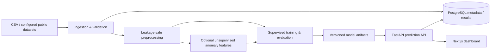

# FinRisk AI

A modular platform for credit risk assessment, fraud detection, transaction pattern discovery, and model experimentation.

## Project status

This repository is being built in the phases in the project brief. The foundation includes the architecture, runnable application skeleton, CSV validation/EDA, leakage-aware splitting and preprocessing, fold-safe imbalance pipelines, baseline classifiers, optional neural network and clustering modules, Optuna tuning, and threshold selection. It contains no provided dataset, saved model, or precomputed performance metric. Public datasets must be downloaded and configured explicitly before analysis.

## Architecture



The initial deployment is a local, batch-oriented research platform. The anomaly score enrichment shown in the supplied references is an optional feature path and must be fitted using training data only. Clusters and anomaly flags are investigative signals, not confirmed fraud labels. Credit outputs are model estimates, not lending decisions.

## Repository layout

```text
backend/                 FastAPI service and modular ML packages
  app/api/routes/        Versioned REST endpoints
  app/core/              Settings and application setup
  app/data/              Dataset ingestion and transformations
  app/models/            ML, deep learning, clustering, registry
  app/services/           Training, prediction, evaluation, XAI
  app/schemas/            API contracts
  app/database/           SQLAlchemy models and session setup
frontend/                Next.js + TypeScript application
datasets/{raw,processed}/ Local data (not committed)
ml_artifacts/             Versioned models and reports (not committed)
docs/                     Architecture and data setup notes
```

## Run locally

Requirements: Python 3.11+, Node.js 22.13+, npm, and Docker Compose (for PostgreSQL).

For the full container stack, copy `.env.example` to `.env`, set `POSTGRES_PASSWORD`, then run `docker compose up --build`. Compose starts PostgreSQL, applies the Alembic migration, and starts the API and frontend. The local dev password fallback is only intended for isolated development.

1. Copy `.env.example` to `.env` and review the values.
2. Start PostgreSQL: `docker compose up -d db`.
3. Start the API:

   ```powershell
   cd backend
   python -m venv .venv
   .\.venv\Scripts\Activate.ps1
   pip install -r requirements.txt
   uvicorn app.main:app --reload
   ```

4. Start the UI in another terminal:

   ```powershell
   cd frontend
   npm install
   npm run dev
   ```

API docs: <http://localhost:8000/docs>. Frontend: <http://localhost:3000>. Interactive workbench: <http://localhost:3000/workbench>. The API exposes validated CSV profiling, baseline training/evaluation, clustering, model listing (`GET /api/v1/models`), fraud scoring (`POST /api/v1/predictions/fraud`), and credit-risk scoring (`POST /api/v1/predictions/credit-risk`). Training requests save a versioned local model artifact by default; the selected task and positive label are explicit. Set `include_explanations=true` to compute bounded SHAP summaries and row explanations (requires `requirements-xai.txt`). With `PERSISTENCE_ENABLED=true`, experiment metadata and validation metrics are stored in PostgreSQL; uploaded feature rows are not. Training deliberately leaves the held-out test partition unevaluated. Install optional `requirements-dl.txt` and `requirements-optuna.txt` for PyTorch and Optuna.

## Dataset setup

Place datasets locally under `datasets/raw/` and keep them out of version control. Use the original dataset documentation and license. For the Kaggle European cardholder fraud dataset, download it through Kaggle and place the CSV in `datasets/raw/`; do not include credentials or the dataset in this repository. Credit risk dataset support will use explicit dataset adapters and a target-column configuration. No data is fetched automatically and no synthetic results are presented as real.

## Development phases

1. Architecture and environment setup — scaffold established here.
2. Dataset adapters and EDA report — CSV upload profiling is available at `POST /api/v1/datasets/profile`.
3. Leakage-safe preprocessing and feature engineering — split-first imputation, scaling, categorical encoding, chronological or stratified partitions, and train-fitted mutual information, RFE, and random forest feature selectors are available.
4. Imbalance strategies — random over/undersampling, SMOTE, ADASYN, SMOTEENN, and class weights are available through fold-safe training pipelines.
5. Classical models and initial evaluation — six baseline classifiers and validation recall, PR-AUC, precision, F1, specificity, ROC-AUC, MCC, balanced accuracy, accuracy, and confusion matrix are available.
6. Neural networks and autoencoder experiments — optional PyTorch classifier, focal loss, and reconstruction-score modules are provided; install `requirements-dl.txt`.
7. Clustering and dimensionality reduction — K-Means, DBSCAN, hierarchical clustering, Gaussian mixtures, PCA, and t-SNE are exposed at `POST /api/v1/clustering/discover`.
8. Optuna optimization — PR-AUC random forest tuning over stratified training folds is available in `app.services.optimization`; install `requirements-optuna.txt`.
9. Robust validation, threshold selection, and reports — baseline metric computation and a configurable validation FPR threshold selector are implemented; time-aware held-out splits are supported.
10. Explainability — bounded SHAP global and local probability contributions are available on training evaluation requests when `include_explanations=true`.
11. FastAPI data, training, clustering, registry, and model inference routes are implemented.
12. Interactive dashboard — `/workbench` supports CSV profiling, baseline evaluation, SHAP summaries, feature selection, imbalance choices, clustering, and scoring a registered model. Authentication and the remaining dedicated pages are pending.
13. PostgreSQL persistence and migrations — metadata schema, initial Alembic migration, and optional training-run persistence are provided. Raw uploaded feature rows are not stored.
14. Quality and deployment — backend tests are in place; frontend dependency installation and a full container build still need verification in an environment with a complete npm install and a running Docker daemon.

Each phase should use actual configured data, record provenance, and avoid reporting fabricated metrics.
